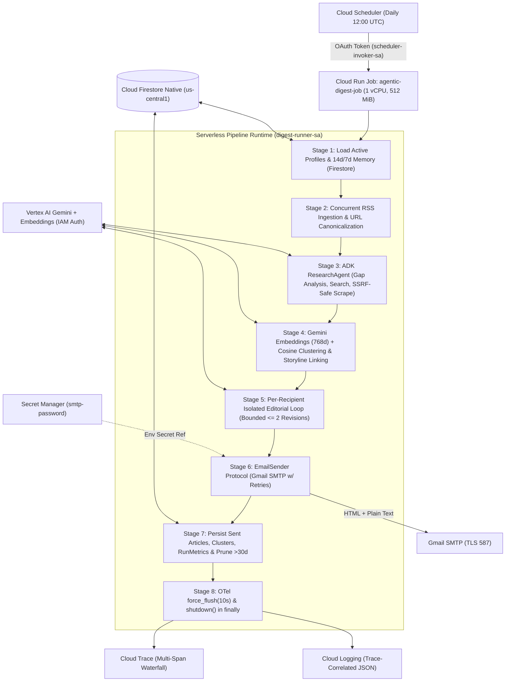
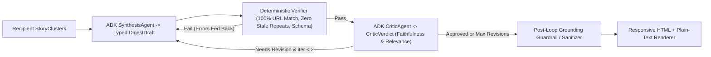

# System Architecture — Agentic Emailer (`v1.0`)

Agentic Emailer is a serverless, multi-agent news intelligence and executive digest system built with **Google Agent Development Kit (`google-adk`)**, **Vertex AI Gemini**, **Cloud Firestore**, **OpenTelemetry -> Cloud Trace**, and **Terraform** on Google Cloud Platform.

It is engineered for a small curated group (2–20 recipients) running on a daily schedule with **\$0/month out-of-pocket infrastructure cost** inside GCP's Always Free tier plus \$10/month Google AI Pro developer credits.

---

## 1. High-Level Production Topology

### Bounded Editorial Loop (Stage 5 Detail)

---

## 2. Pipeline Stage Breakdown

1. **Stage 1 — Profile & Memory Loading (`memory/`):** Loads enabled `RecipientProfile` documents from Firestore (`recipients/`), trailing 14-day `seen_articles` canonical URLs (single-field range filter + `select(["canonical_url"])` projection), and trailing 7-day `story_clusters` with 768-dim embeddings.
2. **Stage 2 — Deterministic RSS Ingestion (`ingestion/rss.py`):** Pools unique RSS feeds across active recipients, fetches concurrently via `httpx`, normalizes URLs (stripping `utm_*`, `fbclid`, `gclid`, fragments, default ports), and computes deterministic 16-char SHA-256 `article_id` keys.
3. **Stage 3 — Adaptive `ResearchAgent` (`agents/research_agent.py`):** A Google ADK `LlmAgent` inspecting the live RSS inventory and deciding whether to call `fetch_article_content` (SSRF-hardened `httpx` + `trafilatura` full-text extraction for thin snippets) or `search_web_news` (DuckDuckGo fallback for uncovered topics), strictly bounded by `RunBudgetTracker`.
4. **Stage 4 — Hybrid Semantic Deduplication, Clustering & Storyline Linking (`memory/embeddings.py`, `memory/clustering.py`):** Embeds unseen candidate articles in batches with `gemini-embedding-001` (`output_dimensionality=768`, `SEMANTIC_SIMILARITY`) and runs deterministic in-process `numpy` cosine similarity:
   - `sim >= 0.84` (same-day): merges multi-outlet coverage into one `StoryCluster`.
   - `sim >= 0.94` (against prior 7-day clusters): suppresses cross-day near-duplicate re-hashes even on a brand-new URL.
   - `0.76 <= sim < 0.94` (against prior 7-day clusters): marks `is_developing_story = True` and attaches `prior_story_summary` + `prior_digest_date`.
5. **Stage 5 — Per-Recipient Editorial Loop (`pipeline.py`, `agents/synthesis_agent.py`, `agents/verifier.py`, `agents/critic_agent.py`):** Runs in isolation per recipient. `SynthesisAgent` emits a strict Pydantic `DigestDraft`; `verifier.py` enforces 100% verbatim URL grounding, zero stale repeats, and highlight caps deterministically; `CriticAgent` audits semantic faithfulness and relevance with up to 2 bounded revision cycles.
6. **Stage 6 — Delivery (`delivery/`):** Renders responsive inline-CSS HTML + plain-text multipart emails and dispatches through the `EmailSender` protocol (`SmtpEmailSender` with exponential backoff on transient SMTP errors). One recipient failure never aborts other recipients.
7. **Stage 7 — State Persistence & Programmatic Retention (`memory/firestore_store.py`):** Writes `seen_articles` (using `ArrayUnion` with zero extra reads), upserts `story_clusters` (chunked `AsyncWriteBatch` <= 400 ops), persists `RunMetrics` + `trace_id` to `runs/{run_id}`, and programmatically prunes `seen_articles` and `story_clusters` older than 30 days.
8. **Stage 8 — Observability Flush (`observability/`):** `TelemetryHandle.shutdown()` executes `provider.force_flush(timeout_millis=10_000)` followed by `provider.shutdown()` inside a `finally` block so Cloud Run Job container exit never loses spans.

---

## 3. Key Architectural Trade-Offs

| Decision | Chosen Design | Rejected Alternative | Engineering Rationale |
|---|---|---|---|
| **Agent Orchestration** | Deterministic Python stage orchestrator (`pipeline.py`) calling atomic ADK `LlmAgent`s (`ResearchAgent`, `SynthesisAgent`, `CriticAgent`) | Unconstrained autonomous multi-agent loops or opaque framework graphs | Every LLM call must earn its token cost and latency. Deterministic plumbing handles RSS, canonicalization, URL grounding, clustering math, and retries with zero hallucination risk; LLMs are bounded strictly to adaptive research, editorial synthesis, and semantic critique. |
| **Semantic Memory & Clustering** | Cloud Firestore Native (`us-central1`) + `gemini-embedding-001` (768d) + in-process `numpy` cosine similarity | Managed vector database (Vertex AI Vector Search, Pinecone, AlloyDB) | A 7-day window holds <150 story clusters (~6 KB each). Loading 150 docs in one query and computing a `150 x 768` matrix product in `numpy` takes <2 ms and costs **\$0.00/month** inside Firestore Always Free quotas, whereas managed vector DBs start at \$50–\$150+/month. |
| **Verification Strategy** | Eval-first (`evals/` golden corpus + LLM-as-judge + tool trajectories) + 10 thin zero-mock deterministic invariants (`tests/`) | Mock-heavy unit TDD mocking `genai.Client`, ADK `Runner`, or Firestore SDK internals | Mocking LLM responses tests brittle string fixtures rather than digest quality. Pure invariants guarantee hard safety rails (SSRF, budgets, URL grounding, clustering math) in <2 seconds, while offline evals measure real faithfulness, leakage, recall, latency, and cost. |
| **Email Transport** | Gmail SMTP behind `EmailSender` Protocol (`delivery/protocol.py`) | Hardcoded SendGrid / Mailgun SDK coupling | For 2–20 curated recipients/day, Gmail SMTP with an App Password stored in Secret Manager is free and reliable. Abstracting behind `EmailSender` allows swapping to SendGrid/SES/Resend later without touching pipeline logic. |
| **CI/CD Authentication** | Keyless GitHub OIDC Workload Identity Federation strictly scoped to `refs/heads/main` (`deploy.yml`) + `GEMINI_API_KEY` secret isolated to manual/release evals (`eval-full.yml`) | Long-lived GCP Service Account JSON keys or loosening WIF conditions for tags/PRs | Zero static GCP credentials exist anywhere. Keeping WIF locked to `assertion.repository == '<repo>' && assertion.ref == 'refs/heads/main'` protects production Artifact Registry and Cloud Run Job permissions while letting manual/tag LLM-as-judge evals run cleanly via `GEMINI_API_KEY`. |
| **Firestore Retention** | Programmatic 30-day batch deletion at end of each run | Managed Firestore TTL policies | Deleting ~50–100 expired docs/day uses <0.5% of Firestore's 20,000 Always Free daily deletes while avoiding managed TTL delete billing nuances and keeping retention logic explicit and testable. |

---

## 4. Failure Modes & Guardrails

| Failure Mode | Mitigation / Guardrail | Implementation Location |
|---|---|---|
| **Hallucinated or malformed citation URLs** | Hard 100% deterministic URL verifier checks every citation against allowed corpus; post-loop sanitizer strips ungrounded citations or falls back to deterministic digest if needed. | `src/agentic_emailer/agents/verifier.py`, `src/agentic_emailer/pipeline.py` |
| **Stale repeats & cross-day re-hashes** | Exact canonical URL lookup (14-day window) + semantic cosine suppression (`sim >= 0.94` against 7-day clusters) + deterministic verifier check. | `src/agentic_emailer/memory/clustering.py`, `src/agentic_emailer/agents/verifier.py` |
| **Runaway LLM loops or credit burn** | Thread-safe `RunBudgetTracker` enforces hard per-run ceilings (`60` LLM calls, `350,000` tokens, `20` scrapes, `20` searches, `max_critic_revisions=2`) plus GCP Billing Budget alerts at 20%/50%/80%/100% of \$10/mo. | `src/agentic_emailer/budget.py`, `infra/terraform/budgets.tf` |
| **SSRF via malicious RSS/search links** | Pre-request and per-redirect IP validation blocks loopback, RFC1918 private ranges, CGNAT, link-local, GCP metadata (`169.254.169.254`, `metadata.google.internal`), IPv4-mapped/NAT64/6to4 IPv6 bypasses, and non-HTTP schemes; pins resolved IP on connect. | `src/agentic_emailer/ingestion/extractor.py` |
| **Partial failure across recipients** | Each recipient runs in an isolated `try/except` block; one SMTP or synthesis failure records a failed `DeliveryReceipt` without aborting remaining recipients. | `src/agentic_emailer/pipeline.py` |
| **Transient Gemini/SMTP errors** | Exponential backoff retries on `429`/`500`/`502`/`503`/`504` and timeouts; graceful deterministic fallback digest guarantees delivery resilience if LLM synthesis fails entirely. | `src/agentic_emailer/agents/runtime.py`, `src/agentic_emailer/delivery/smtp_sender.py` |
| **Lost OpenTelemetry spans on Cloud Run exit** | `TelemetryHandle.shutdown()` runs `provider.force_flush(timeout_millis=10_000)` and `provider.shutdown()` inside `finally` blocks in both `cli.py` and `pipeline.py`. | `src/agentic_emailer/observability/telemetry.py`, `src/agentic_emailer/cli.py` |

---

## 5. Measured Evaluation Scorecard

Measured live on the frozen golden corpus (3 recipient profiles + 2 `ResearchAgent` trajectories), graded by an independent `gemini-3.5-flash` LLM-as-judge (full data and methodology in [`evals/reports/experiment-model-comparison.md`](../evals/reports/experiment-model-comparison.md)):

| Metric | Single-Shot Baseline (`gemini-3.1-flash-lite`) | Full Agentic Default (`gemini-3.1-flash-lite`) | Full Agentic Upgraded (`gemini-3.5-flash`) | Gate |
|---|---:|---:|---:|---|
| `schema_validity_rate` | `1.0000` | `1.0000` | `1.0000` | `== 1.0000` |
| `url_grounding_rate` | `1.0000` | `1.0000` | `1.0000` | `== 1.0000` |
| `duplicate_leakage_rate` | `0.0370` (FAIL) | **`0.0000`** | `0.0000` | `== 0.0000` |
| `developing_story_recall` | `0.0000` (FAIL) | **`1.0000`** | `1.0000` | `>= 0.8000` |
| `cluster_compression_ratio` | `1.0000x` | **`1.0870x`** | `1.0870x` | info |
| `topic_coverage_rate` | `1.0000` | `1.0000` | `1.0000` | `>= 0.8500` |
| `trajectory_precision` | `1.0000` | `1.0000` | `1.0000` | `>= 0.8000` |
| `avg_latency_ms` / case | `11,580.1 ms` | **`9,943.8 ms`** | `61,715.6 ms` | info |
| `estimated_cost_usd` (suite) | `$0.002782` | **`$0.004113`** | `$0.009338` | info |
| Judge (`Faith / Rel / Syn / Conc`) | `5.0 / 5.0 / 5.0 / 5.0` | **`5.0 / 5.0 / 5.0 / 5.0`** | `5.0 / 5.0 / 5.0 / 5.0` | `F >= 4.0` (targets `4.0 / 4.0 / 3.8 / 4.0`) |
| **Gate Status** | **FAILED** | **PASSED** | **PASSED** | All pass |

---

## 6. Online Observability & Telemetry

- **Distributed Tracing (`observability/telemetry.py`):** OpenTelemetry `TracerProvider` exports spans to Google Cloud Trace via `CloudTraceSpanExporter` (`BatchSpanProcessor`) when `OTEL_CLOUD_TRACE_ENABLED=true`, augmented by `GoogleGenAiSdkInstrumentor` for automatic Gemini latency and token spans.
  - Span hierarchy: `digest.run` -> `ingestion.rss`, `agent.research`, `memory.embed_and_cluster`, `recipient.editorial_loop` (`agent.synthesis`, `verifier.deterministic`, `agent.critic`), `delivery.send`, `memory.persist_and_prune`.
- **Trace-Correlated Structured JSON Logging (`observability/logging_config.py`):** When `LOG_FORMAT=json` (configured in `infra/terraform/cloud_run.tf`), every log record emits single-line GCP Cloud Logging JSON containing `severity`, `message`, `logger`, `timestamp`, async-bound `run_id` / `recipient_id`, `logging.googleapis.com/trace` (`projects/{project_id}/traces/{trace_id}`), `logging.googleapis.com/spanId`, and `logging.googleapis.com/trace_sampled`.
- **Online Run Telemetry (`agentic-emailer inspect-runs`):** Every run writes `RunMetrics` (including `trace_id`, articles gathered/deduped, clusters, developing links, LLM calls, tokens, estimated USD cost, and grounding pass rate) to Firestore `runs/{run_id}` (or `.local_memory/runs.json` locally) for zero-SaaS operational monitoring.

---

## 7. Monthly GCP Cost & Always Free Guardrails

Projected monthly cost for 10 recipients/day (30 days/month) in `us-central1`:

| GCP Service | Terraform Configuration | Always Free Limit | Projected Monthly Cost |
|---|---|---|---|
| **Cloud Run Jobs** | `agentic-digest-job` (1 vCPU, 512 MiB, ~3 min/day) | 180k vCPU-sec / 360k GiB-sec | **\$0.00** |
| **Cloud Scheduler** | 1 daily job (`daily-agentic-digest`, `0 12 * * *` UTC) | 3 jobs | **\$0.00** |
| **Cloud Firestore** | Native mode in `us-central1`, programmatic 30d pruning | 50k reads, 20k writes, 20k deletes/day; 1 GiB | **\$0.00** |
| **Secret Manager** | 1 secret (`agentic-emailer-smtp-password`, <= 6 versions) | 6 active versions, 10k accesses | **\$0.00** |
| **Artifact Registry** | Cleanup policy keeps latest 3 images, deletes older >24h | 0.5 GiB storage | **\$0.00** |
| **Cloud Trace & Logging** | Structured JSON logs + OTel stage/GenAI spans | 2.5M spans/mo, 50 GiB logs/mo | **\$0.00** |
| **Vertex AI Gemini + Embeddings** | Daily runs (~$0.004/2-recipient dry-run) + on-demand evals | Covered by \$10/mo Google AI Pro credits | **~\$0.50–\$2.00** (covered by credits) |
| **Gmail SMTP** | `EmailSender` protocol via TLS 587 | Personal Gmail quota (~500/day) | **\$0.00** |
| **Total Out-of-Pocket** | | | **\$0.00 / month** |
