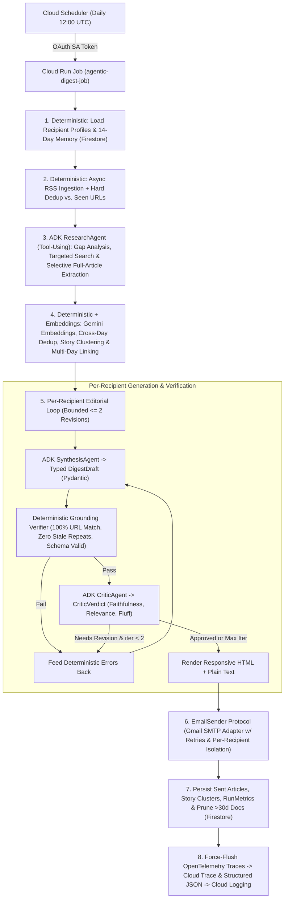

# Production Agentic Digest System — Master Design Specification

> **Date:** 2026-11-26  
> **Target Positioning:** Agentic AI / Applied AI Engineer portfolio project  
> **Operating Envelope:** Small curated group (2–20 recipients), daily scheduled batch run, Google Cloud Always Free tier + \$10/month Google AI Pro developer credits  
> **Orchestration Framework:** Google Agent Development Kit (`google-adk`) on Vertex AI Gemini (with local Gemini API key fallback)

---

## 1. Execution & Verification Policy (Read First)

> [!IMPORTANT]
> **Eval-First Verification Policy (No Mock-Heavy Unit TDD)**
>
> **Do NOT write mock-heavy unit tests or chase artificial code coverage on this repository.**
>
> 1. **Never write mock-LLM unit tests** (no mocking `genai.Client`, Google ADK `Runner`, Firestore SDK internals, or asserting on prompt text fragments). Those tests are brittle and measure nothing about digest quality.
> 2. **Keep `tests/` strictly limited to thin deterministic invariants (~10 fast checks total):** URL canonicalization, cross-day duplicate exclusion, cosine clustering determinism on synthetic vectors, deterministic grounding verifier catching invented URLs, Pydantic schema rejection of malformed drafts, SSRF IP blocking, and `RunBudgetTracker` hard ceilings.
> 3. **Verify agent quality via `evals/`:** Offline golden-dataset evaluation (deterministic metrics + LLM-as-judge rubrics + ADK tool-trajectory checks) and live `--dry-run` smoke runs.
> 4. **Verify infrastructure via declarative checks:** `ruff check`, `mypy`, `docker build`, `terraform fmt -check`, `terraform validate`, and `terraform plan`.
> 5. **Execute one milestone per fresh Antigravity conversation** on a dedicated git branch, iterating on prompts/thresholds as needed until the Milestone Exit Gate passes, followed by an independent review pass (fresh review subagent or parallel specialist workflow) before merging.

---

## 2. Executive Summary & Evolution from Current Codebase

### Current State (`v0.x`)
The existing repository (`aggregator.py`, `sources.py`, `summarizer.py`, `emailer.py`) is a stateless, linear Python script triggered by GitHub Actions:
- Polls RSS feeds and hardcoded DuckDuckGo templates sequentially; truncates snippets to 500 characters.
- Deduplicates only *within* a single execution—causing repeat stories whenever `lookback_hours` (36h) exceeds the 24h cron interval.
- Sends one single-shot Gemini prompt returning untyped Markdown with zero citation verification, no full-article reading, and no memory of prior digests.
- Relies on mock-heavy unit tests (`tests/test_summarizer.py`) and GitHub Actions secrets instead of cloud infrastructure.

### Target Production State (`v1.0`)
A containerized, serverless, multi-agent GCP system that deliberately separates **deterministic engineering plumbing** from **bounded LLM agency**:



---

## 3. Architectural Principles & Design Boundaries

### 3.1 Deterministic Plumbing vs. True LLM Agency
Every LLM call must earn its token cost and latency:

| Responsibility | Deterministic or Agentic? | Why |
|---|---|---|
| RSS fetching, XML parsing, URL canonicalization | **Deterministic** (`httpx` + `feedparser`) | Fast, free, repeatable, zero hallucination risk. |
| Cross-day exact URL deduplication | **Deterministic** (Firestore lookup) | Hard guarantee that sent URLs are never re-sent. |
| Deciding search queries & which thin snippets merit full-page scraping | **Agentic** (`ResearchAgent`, ADK `LlmAgent` + tools) | Adapts to what RSS actually returned that day instead of running blind static templates. |
| Multi-outlet story clustering & multi-day storyline linking | **Hybrid** (`gemini-embedding-001` + deterministic cosine clustering) | Semantic grouping without brittle keyword rules or expensive pairwise LLM prompts. |
| Editorial prioritization & synthesis per recipient | **Agentic** (`SynthesisAgent`, ADK `LlmAgent` + Pydantic `output_schema`) | Synthesizes multi-source clusters into structured executive briefing tailored to recipient topics. |
| URL existence, citation integrity, stale-story ban, schema check | **Deterministic** (`verifier.py`) | Hard 100% guardrail; LLMs must never be solely trusted to check URL strings. |
| Semantic faithfulness, claim support & editorial quality review | **Agentic** (`CriticAgent`, ADK `LlmAgent`) | Catches subtle overclaiming, hallucinated nuance, and generic filler before email dispatch. |
| HTML rendering, SMTP delivery, retry, telemetry flush | **Deterministic** (`delivery/`, `observability/`) | Reliable delivery isolated per recipient; one failed email never aborts other recipients. |

### 3.2 Google ADK Orchestration Pattern
- **Atomic Agents (`google.adk.agents.LlmAgent`):** `ResearchAgent`, `SynthesisAgent`, and `CriticAgent` are built as standalone ADK `LlmAgent` definitions with explicit tools, Pydantic `output_schema`, and clean prompts.
- **Explicit Python Pipeline Orchestration:** Rather than relying on legacy/deprecated ADK workflow wrappers (`SequentialAgent`/`LoopAgent`), `pipeline.py` orchestrates stage transitions, bounded revision loops (`max_revisions=2`), concurrency semaphores, and `RunBudgetTracker` guardrails directly in async Python while invoking each ADK agent through `google.adk.runners.Runner` + `InMemorySessionService`.
- **Dual Backend Support (Vertex AI + Local Gemini API):** Controlled purely by configuration (`GOOGLE_GENAI_USE_VERTEXAI=true` in GCP Cloud Run using attached Service Account IAM; `GOOGLE_GENAI_USE_VERTEXAI=false` + `GEMINI_API_KEY` locally for dev and offline evals).

### 3.3 Hard Cost & Runaway Protection (`RunBudgetTracker`)
To guarantee the system can **never** burn through the \$10/month Google AI Pro credit:
- Global per-run limits configured in `Settings` (defaults):
  - `max_llm_calls_per_run = 60`
  - `max_total_tokens_per_run = 350_000`
  - `max_article_scrapes_per_run = 20`
  - `max_search_calls_per_run = 20`
  - `max_critic_revisions_per_recipient = 2`
- If a budget ceiling is reached mid-run:
  - Research stops further tool calls and proceeds with already-gathered articles.
  - Critic loop short-circuits after deterministic verification passes.
  - If synthesis itself fails or exceeds budget, graceful deterministic fallback digest is generated (preserving the resilience of `v0.x` without crashing the job).

---

## 4. Target Package & Repository Structure

```text
agentic_emailer/
├── pyproject.toml                         # uv package=true, hatchling build, ruff/mypy/pytest config
├── Dockerfile                             # Multi-stage python:3.12-slim + uv production container
├── .dockerignore
├── src/
│   └── agentic_emailer/
│       ├── __init__.py
│       ├── cli.py                         # Entry point: `agentic-emailer run|seed-profiles|eval`
│       ├── config.py                      # Pydantic Settings (models, GCP project, budgets, SMTP)
│       ├── models.py                      # Core Pydantic domain models
│       ├── budget.py                      # Hard per-run LLM / token / scrape / search budget guard
│       ├── pipeline.py                    # End-to-end async orchestrator
│       ├── ingestion/
│       │   ├── __init__.py
│       │   ├── rss.py                     # Concurrent RSS ingestion + canonical URL normalization
│       │   ├── search.py                  # DuckDuckGo news/text wrapper w/ timeouts + rate limiting
│       │   └── extractor.py               # SSRF-safe full-text extraction (httpx + trafilatura)
│       ├── memory/
│       │   ├── __init__.py
│       │   ├── protocol.py                # MemoryStore Protocol
│       │   ├── local_json.py              # Local JSON-backed store (dev + offline evals)
│       │   ├── firestore_store.py         # Production Firestore implementation (Always Free)
│       │   ├── embeddings.py              # Batch embeddings via google-genai (768-dim)
│       │   └── clustering.py              # Cosine story clustering + multi-day storyline linker
│       ├── agents/
│       │   ├── __init__.py
│       │   ├── runtime.py                 # ADK Runner wrapper, token accounting, structured output parsing
│       │   ├── research_agent.py          # Adaptive Research ADK LlmAgent + tools
│       │   ├── synthesis_agent.py         # Editorial Synthesis ADK LlmAgent -> DigestDraft
│       │   ├── critic_agent.py            # Grounding & Quality Critic ADK LlmAgent -> CriticVerdict
│       │   └── verifier.py                # Deterministic URL / freshness / schema grounding verifier
│       ├── delivery/
│       │   ├── __init__.py
│       │   ├── protocol.py                # EmailSender Protocol -> DeliveryReceipt
│       │   ├── renderer.py                # Styled responsive HTML + plain-text renderer
│       │   └── smtp_sender.py             # Gmail SMTP adapter w/ backoff retry
│       └── observability/
│           ├── __init__.py
│           ├── logging_config.py          # GCP Cloud Logging JSON formatter w/ trace correlation
│           └── telemetry.py               # OpenTelemetry + Cloud Trace exporter + GenAI instrumentation
├── tests/                                 # THIN deterministic invariants ONLY (~6-10 tests)
│   ├── test_invariants_dedup.py
│   ├── test_invariants_grounding.py
│   └── test_invariants_budget.py
├── evals/
│   ├── __init__.py
│   ├── datasets/
│   │   ├── golden_corpus.json             # Frozen multi-profile articles + prior-day memory + edge cases
│   │   └── trajectory_cases.json          # ResearchAgent tool-use trajectory scenarios
│   ├── metrics.py                         # Deterministic quality, grounding, dedup, cost & trajectory metrics
│   ├── judges.py                          # Gemini LLM-as-judge rubrics (faithfulness, relevance, novelty, conciseness)
│   ├── runner.py                          # Eval CLI producing JSON + Markdown scorecards + threshold gating
│   └── reports/
│       └── baseline.json                  # Committed baseline eval scorecard for regression comparison
├── infra/
│   └── terraform/
│       ├── versions.tf
│       ├── variables.tf
│       ├── main.tf                        # APIs, Artifact Registry (+ cleanup), Firestore, Secret Manager
│       ├── iam.tf                         # 3 least-privilege SAs + GitHub OIDC Workload Identity Federation
│       ├── cloud_run.tf                   # Cloud Run Job + Cloud Scheduler daily trigger
│       ├── budgets.tf                     # GCP Billing Budget alerts ($2/$5/$8/$10)
│       └── outputs.tf
├── .github/
│   └── workflows/
│       ├── ci.yml                         # PR checks: ruff, mypy, thin invariants, deterministic offline evals
│       ├── deploy.yml                     # Main push: build container -> Artifact Registry -> update Cloud Run Job (via WIF)
│       └── eval-full.yml                  # Manual / release LLM-as-judge regression suite + scorecard artifact
└── docs/
    ├── ARCHITECTURE.md                    # Portfolio-ready system design doc & diagrams
    ├── GCP_BOOTSTRAP.md                   # One-time GCP + Google AI Pro setup runbook
    └── plans/
        ├── DESIGN_SPEC.md                 # This master specification
        ├── milestone-1-adk-pipeline-and-evals.md
        ├── milestone-2-firestore-memory-and-clustering.md
        ├── milestone-3-gcp-terraform-and-cicd.md
        └── milestone-4-observability-online-evals-and-polish.md
```

---

## 5. Core Data Contracts (`models.py`)

All cross-stage data uses strict Pydantic v2 models so serialization (Firestore, eval snapshots, structured LLM output, telemetry) is uniform and validated:

- **`RecipientProfile`:** `id: str`, `email_address: str`, `subject_prefix: str`, `enabled: bool`, `topics: list[str]`, `rss_feeds: list[RssFeedConfig]`, `lookback_hours: int = 36`, `max_highlights: int = 8`.
- **`RawArticle`:** `article_id: str` (deterministic SHA-256 prefix of canonical URL), `canonical_url: str`, `url: str`, `title: str`, `source: str`, `published_at: datetime | None`, `snippet: str`, `full_text: str | None = None`, `discovered_via: Literal["rss", "search"]`, `topic_hints: list[str]`.
- **`StoryCluster`:** `cluster_id: str`, `canonical_title: str`, `topic: str`, `articles: list[RawArticle]`, `embedding: list[float] | None`, `is_developing_story: bool = False`, `prior_story_summary: str | None = None`, `prior_digest_date: str | None = None`.
- **`DigestHighlight`:** `title: str`, `topic: str`, `summary: str`, `why_it_matters: str`, `story_status: Literal["new", "developing_update"]`, `citations: list[Citation]` (each `Citation` has `source_name: str`, `url: str`, `article_id: str`).
- **`DigestDraft`:** `title: str`, `executive_summary: str`, `highlights: list[DigestHighlight]`, `notable_trends: list[str]`.
- **`VerificationResult` (Deterministic):** `passed: bool`, `errors: list[str]`, `invalid_urls: list[str]`, `stale_urls: list[str]`.
- **`CriticVerdict` (ADK `CriticAgent`):** `approved: bool`, `faithfulness_score: int` (1–5), `relevance_score: int` (1–5), `issues: list[str]`, `revision_instructions: str`.
- **`DeliveryReceipt`:** `recipient_id: str`, `recipient_email: str`, `status: Literal["sent", "dry_run", "failed"]`, `provider: str`, `error: str | None`, `sent_at: datetime`.
- **`RunMetrics`:** `run_id: str`, `started_at: datetime`, `finished_at: datetime`, `recipients_processed: int`, `recipients_failed: int`, `articles_gathered: int`, `articles_deduped_cross_day: int`, `clusters_formed: int`, `developing_stories_linked: int`, `scrapes_performed: int`, `llm_calls: int`, `input_tokens: int`, `output_tokens: int`, `estimated_cost_usd: float`, `avg_revisions_per_recipient: float`, `deterministic_grounding_pass_rate: float`, `trace_id: str | None`.

---

## 6. Firestore Data Model (Always Free Optimized)

Collection structure in Cloud Firestore Native mode (region: `us-central1` — Tier-1 Always Free eligible):

1. **`recipients/{recipient_id}`**
   - Stores `RecipientProfile` fields. Seeded/updated via `uv run agentic-emailer seed-profiles` CLI (replaces `RECIPIENTS_JSON` secret hack!).
2. **`seen_articles/{article_id}`**
   - Stores `canonical_url`, `title`, `source`, `first_seen_at`, `recipient_ids_sent: list[str]`, `cluster_id`.
   - Loaded once per run (window: last 14 days) to guarantee **zero duplicate re-sends** across consecutive runs.
3. **`story_clusters/{cluster_id}`**
   - Stores `canonical_title`, `topic`, `summary`, `embedding: list[float]` (768-dim via `output_dimensionality=768` on `gemini-embedding-001` to keep doc sizes tiny ~6 KB), `urls: list[str]`, `created_at`, `last_updated_at`.
   - Loaded once per run (window: last 7 days, typically <150 docs) for fast in-process numpy cosine similarity:
     - Same-day cluster threshold (`>= 0.84`): merge multi-outlet coverage of the same announcement into one `StoryCluster`.
     - Cross-day storyline threshold (`0.76 <= sim < 0.94` against prior 7-day clusters with new URL): mark `is_developing_story = True` and attach `prior_story_summary` so the SynthesisAgent writes *"Update on [date]'s story..."*.
     - Cross-day near-duplicate threshold (`>= 0.94` against prior 14-day sent cluster): suppress as redundant re-hash even if published on a different URL!
4. **`runs/{run_id}`**
   - Stores `RunMetrics` + per-recipient summary (status, revision count, critic scores, trace ID). Powers online quality tracking without third-party SaaS.
5. **Programmatic Retention Cleanup (Zero TTL Billing Risk):**
   - At the end of each run, delete `seen_articles` and `story_clusters` docs older than 30 days (~50–100 deletes/day out of 20,000 Always Free daily deletes). Avoids Firestore managed TTL billing nuances.

---

## 7. Model Selection & Monthly Budget Math (GCP + Google AI Pro)

Configurable via environment variables in `config.py`:
- `RESEARCH_MODEL` default: `gemini-3.1-flash-lite` (fast, ultra-low-cost tool calling)
- `SYNTHESIS_MODEL` default: `gemini-3.1-flash-lite` (upgradable via env var to `gemini-3-flash` / `gemini-3.5-flash` and benchmarked cleanly via `evals/`!)
- `CRITIC_MODEL` default: `gemini-3.1-flash-lite` (or stronger judge model in offline evals, e.g., `gemini-3-flash`)
- `EMBEDDING_MODEL` default: `gemini-embedding-001` (`output_dimensionality=768`)

### Projected Monthly GCP Cost (10 recipients/day, 30 days/month)

| GCP Service | Projected Usage | Always Free Limit | Estimated Monthly Cost |
|---|---|---|---|
| **Cloud Run Jobs** (1 vCPU, 512 MiB, ~3 min/day) | ~5,400 vCPU-sec / 2,700 GiB-sec | 180,000 vCPU-sec / 360,000 GiB-sec | **\$0.00** |
| **Cloud Scheduler** | 1 daily job | 3 jobs | **\$0.00** |
| **Cloud Firestore** (`us-central1`) | ~500 reads, ~200 writes, ~100 deletes/day; <50 MB | 50k reads, 20k writes, 20k deletes/day; 1 GiB | **\$0.00** |
| **Secret Manager** | 1 active secret version (`smtp-password`) | 6 active secret versions, 10k accesses | **\$0.00** |
| **Artifact Registry** | <350 MB (cleanup policy keeps latest 3 images) | 0.5 GiB | **\$0.00** |
| **Cloud Trace & Cloud Logging** | <10k spans/mo, <100 MB logs/mo | 2.5M spans/mo, 50 GiB logs/mo | **\$0.00** |
| **Vertex AI Gemini + Embeddings** | Daily runs + ~10 monthly eval runs | Covered by \$10/mo Google AI Pro credits | **~\$0.50–\$2.50** (covered by credits) |
| **Gmail SMTP** | 2–20 emails/day via `EmailSender` adapter | Personal Gmail limit (~500/day) | **\$0.00** |
| **TOTAL OUT-OF-POCKET** | | | **\$0.00** (well inside \$10/mo credit) |

---

## 8. Eval & Observability Design

### 8.1 Offline Eval Harness (`evals/`)
Evaluates the real pipeline against frozen deterministic inputs (`evals/datasets/golden_corpus.json`) so prompt, model, or clustering changes can be scientifically A/B compared:
- **Deterministic Metrics (`evals/metrics.py`):**
  - `schema_validity_rate` (target: `1.00`)
  - `url_grounding_rate` — % of cited URLs verbatim-present in allowed input corpus (target: `1.00`)
  - `duplicate_leakage_rate` — % of cited URLs or near-duplicate clusters already in prior-day memory (target: `0.00`)
  - `developing_story_recall` — % of planted multi-day evolving stories correctly flagged `developing_update` (target: `>= 0.80`)
  - `topic_coverage_rate` — % of recipient topics with available news that appear in highlights (target: `>= 0.85`)
  - `trajectory_precision` — for `ResearchAgent`, whether thin-snippet articles triggered `fetch_article_content` while already-rich articles skipped unnecessary scrapes (target: `>= 0.80`)
  - `avg_latency_ms` and `estimated_cost_usd`
- **LLM-as-Judge Rubrics (`evals/judges.py`):**
  - `faithfulness` (1–5): Every factual claim in summary + `why_it_matters` is strictly supported by source snippets/full text. (gate: `>= 4.2`)
  - `relevance` (1–5): Highlights match recipient topics without off-topic noise. (gate: `>= 4.0`)
  - `synthesis_quality` (1–5): Clusters multiple sources smoothly, highlights genuine significance rather than copy-pasting headlines. (gate: `>= 3.8`)
  - `conciseness` (1–5): Scannable executive briefing format suitable for a 2-minute morning read. (gate: `>= 4.0`)
- **Scorecard Artifacts:** Each run writes structured JSON + human-readable Markdown summary comparing against `evals/reports/baseline.json` (showing deltas per metric).

### 8.2 Online Observability (`observability/`)
- **OpenTelemetry -> Cloud Trace:** Root span `digest.run` wrapping child spans `ingestion.rss`, `agent.research`, `memory.cluster`, `recipient.<id>.editorial_loop`, `agent.synthesis`, `verifier.deterministic`, `agent.critic`, and `delivery.send`, plus `GoogleGenAiSdkInstrumentor` capturing model latency and token usage.
- **Explicit Flush Before Container Exit:** `telemetry.shutdown()` calls `provider.force_flush(timeout_millis=10000)` + `provider.shutdown()` in a `finally` block so Cloud Run Job termination never drops trailing spans.
- **Structured JSON Logging:** Emits GCP Cloud Logging JSON (`severity`, `message`, `logging.googleapis.com/trace`, `run_id`, `recipient_id`) so every log line correlates directly to its Cloud Trace waterfall.

---

## 9. Phased Execution Roadmap (Antigravity)

Execute these 4 milestone plans **in strict order**—one fresh Antigravity conversation and git branch per milestone—validating each Milestone Exit Gate and running an end-of-milestone review pass before merging and starting the next:

1. **Milestone 1 (`docs/plans/milestone-1-adk-pipeline-and-evals.md` — recommended: `/boost` or `/goal`):** Refactor to `src/` package, build Pydantic contracts, budget tracker, async ingestion + selective article extractor, Google ADK `ResearchAgent` / `SynthesisAgent` / `CriticAgent`, deterministic grounding verifier, clean `EmailSender` + HTML renderer, thin invariant tests (removing old mock tests), and offline eval harness running locally.
2. **Milestone 2 (`docs/plans/milestone-2-firestore-memory-and-clustering.md` — recommended: `/goal`):** Implement `MemoryStore` protocol, `LocalJsonMemoryStore`, `FirestoreMemoryStore`, batch Gemini embeddings (`gemini-embedding-001`, 768 dims), cosine story clustering, cross-day dedup, multi-day developing-story linking, `seed-profiles` CLI, and memory-aware eval cases.
3. **Milestone 3 (`docs/plans/milestone-3-gcp-terraform-and-cicd.md` — recommended: `/boost` or `/goal`):** Containerize with multi-stage `uv` Dockerfile, provision all GCP infrastructure via Terraform (Cloud Run Job, Cloud Scheduler, Firestore, Secret Manager, Artifact Registry w/ cleanup, 3 least-privilege SAs, GitHub OIDC WIF, Billing Budgets), and wire GitHub Actions CI + keyless CD.
4. **Milestone 4 (`docs/plans/milestone-4-observability-online-evals-and-polish.md` — recommended: `/goal`):** Wire OpenTelemetry -> Cloud Trace + GCP structured JSON logging, persist online `RunMetrics` to Firestore, add manual/release LLM-as-judge CI eval workflow, run baseline model comparison eval (e.g., Flash-Lite vs. Flash), and write portfolio-grade `docs/ARCHITECTURE.md` and updated `README.md`.
